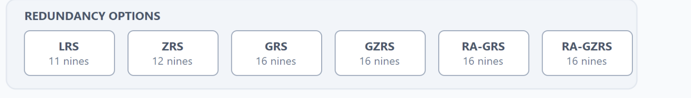
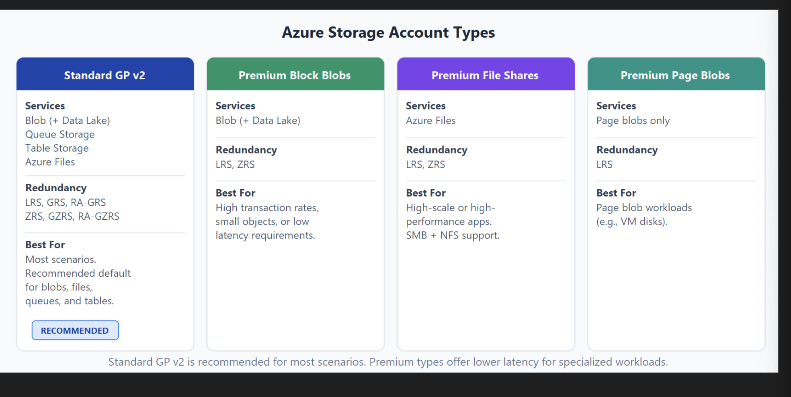
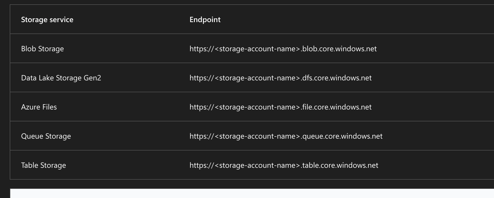

A storage account provides a unique namespace for your Azure Storage data that's accessible from anywhere in the world over HTTP or HTTPS. Data in this account is secure, highly available, durable, and massively scalable.

anatomy of azure storage account

account name: unique namespace

contains

storage services
blobs - objects, data lake, .blob / .dfs - files smb /mfs shares .file - queues: async messaging .queue - tables: NoSQL structured .table

protected by

redudancy options

a storage account provides a unique namespace contains one or more services and is protected by redundancy options and has an impact on the use cases. these redundancy options are covered later in this module

- locally redundant storage
- geo redundant storage
- read acess geo redundant storage
- zone redundant storage
- geo zone redundant storage
- read accesss geo zone redundant storange

standard general purpose

- blob storage including data lake storage, queue storage, table storage and azure files
- redundancy options: all
- usage: recommended for most scenarions using azure storage
  0 if you want support for network file system nfs in azure files use the premium file shares account type

premium blok blobs: blob storage including data lake storage: local and zone redundant storage: premium storage account type for block blobs and append blockes reccommended for scenarios with high transaction rate or that use smaller objects or require consistently low storage latency

premium file shares: azures: local and zone redundant; premium storage account types for file shares only, recommended for high scale or high performance applications, use this account type if you wana storage acount that supports both server message block and nfs file shares

premium page blobs: page blobs only: local redundancy storage

- premium storage account type for page blobs only

